# OpenRouteAI

Italiano · [English](README.md)



Un solo endpoint compatibile con OpenAI per l'AI locale. L'alfa `0.1.0a1` instrada chat testuali verso Ollama e, se configurato, un altro server locale OpenAI-compatible. Il gateway non ha percorsi verso provider remoti e non conserva prompt o risposte.

## Avvio rapido

Servono Python 3.11+, [Ollama](https://ollama.com/) in esecuzione locale e un modello chat installato. Per iniziare con un modello piccolo, [Ollama elenca `llama3.2:1b`](https://ollama.com/library/llama3.2).

```bash
ollama pull llama3.2:1b
python -m venv .venv
# Attiva .venv: PowerShell .\.venv\Scripts\Activate.ps1; Unix: source .venv/bin/activate
python -m pip install -e .
openrouteai doctor
openrouteai serve
```

In un altro terminale installa l'SDK OpenAI con `python -m pip install openai`, poi esegui:

```python
from openai import OpenAI

client = OpenAI(base_url="http://127.0.0.1:4000/v1", api_key="local")
reply = client.chat.completions.create(
    model="auto",
    messages=[{"role": "user", "content": "Ciao"}],
)
print(reply.choices[0].message.content)
```

L'SDK richiede una chiave non vuota. Il gateway su loopback non la usa per autenticare. Mantieni il gateway in ascolto solo su loopback.

## Contratto dell'alfa

- `POST /v1/chat/completions`: messaggi testuali senza streaming con ruoli `system`, `user` o `assistant`; parametri facoltativi `temperature`, `top_p` e `max_tokens`.
- `model="auto"`: scopre i modelli Ollama adatti alla chat tramite `/api/tags` e `/api/show`, poi eventualmente un server locale OpenAI-compatible. Dopo un errore transitorio prova al massimo un altro candidato locale.
- I nomi espliciti sono `ollama/<modello>` o `local/<modello>`. Imposta `OPENROUTEAI_MODEL` a uno di questi identificativi per dargli priorità con `auto`.
- `GET /v1/models`, `GET /health` e `openrouteai doctor`.
- I campi non supportati generano errori nel formato OpenAI. Streaming, tool, embeddings, cloud, cache, dashboard, rate limit e MCP sono [sviluppi successivi](docs/roadmap.it.md).

Per aggiungere un secondo server locale, imposta `OPENROUTEAI_LOCAL_BASE_URL=http://127.0.0.1:1234/v1` nell'ambiente del processo gateway. Il server deve esporre endpoint compatibili `/v1/models` e `/v1/chat/completions`. `.env.example` è un file di riferimento e non viene caricato automaticamente.

## Privacy e funzionamento offline

Il gateway ascolta su loopback, si connette solo a origini HTTP loopback configurate, ignora le variabili proxy per i provider e non stampa prompt, risposte o header di autorizzazione. Esclude i nomi Ollama che terminano in `:cloud`. Un server locale può a sua volta inoltrare richieste a Internet: OpenRouteAI non può certificare il suo comportamento interno. Per usare Ollama rigorosamente offline, imposta `OLLAMA_NO_CLOUD=1` nell'ambiente del **processo Ollama** e riavvialo, come [documentato da Ollama](https://docs.ollama.com/faq#how-do-i-disable-ollama-cloud-features).

## Contribuire

Leggi [CONTRIBUTING.it.md](CONTRIBUTING.it.md) e [l'architettura](docs/architecture.it.md). Esegui `python -m pip install -e '.[test]'` e `python -m pytest -q -p no:cacheprovider`. Il core Python resta sotto 1.500 righe fisiche, controllate dalla CI. Aggiorna la versione inglese di ogni documento pubblico modificato.

## Licenza e sostegno

Copyright © 2026 MRJonam91. Il codice è [AGPL-3.0-only](LICENSE). Condizioni commerciali separate possono essere negoziate per il codice di cui il titolare possiede i diritti o che può rilicenziare; la [politica sui contributi](CONTRIBUTING.it.md) spiega le conseguenze per il codice della comunità. Un fingerprint opaco nel pacchetto e il tag Git della release aiutano a identificare questa versione, ma gli identificativi pubblici non sono segreti né protezioni affidabili contro le copie.

Link per sostenere il progetto: [GitHub Sponsors](https://github.com/sponsors/MRJonam91) · [Ko-fi](https://ko-fi.com/mrjonam) · [Buy Me a Coffee](https://www.buymeacoffee.com/mrjonam) · [PayPal](https://paypal.me/manorollo). Non è configurato Open Collective. La disponibilità effettiva dei profili di pagamento non è stata verificata in modo indipendente.

[Visione](docs/product-brief.it.md) · [Architettura](docs/architecture.it.md) · [Roadmap](docs/roadmap.it.md) · [Ricerca API](docs/research/alpha-contract.it.md).
