# OpenRouteAI

[Italiano](README.it.md) · English



One OpenAI-compatible endpoint for local AI. Alpha `0.1.0a1` routes text chat to Ollama and, if configured, another local OpenAI-compatible server. The gateway has no remote provider route and does not persist prompts or responses.

## Quick start

Requires Python 3.11+, [Ollama](https://ollama.com/) running locally, and an installed chat model. For a small first model, [Ollama lists `llama3.2:1b`](https://ollama.com/library/llama3.2).

```bash
ollama pull llama3.2:1b
python -m venv .venv
# Activate .venv: PowerShell .\.venv\Scripts\Activate.ps1; Unix: source .venv/bin/activate
python -m pip install -e .
openrouteai doctor
openrouteai serve
```

In another terminal, install the OpenAI SDK with `python -m pip install openai` and call:

```python
from openai import OpenAI

client = OpenAI(base_url="http://127.0.0.1:4000/v1", api_key="local")
reply = client.chat.completions.create(
    model="auto",
    messages=[{"role": "user", "content": "Ciao"}],
)
print(reply.choices[0].message.content)
```

The SDK requires a nonempty key. The loopback gateway does not authenticate it. Keep the gateway bound to loopback.

## Alpha contract

- `POST /v1/chat/completions`: non-streaming text messages with `system`, `user`, or `assistant` roles; optional `temperature`, `top_p`, and `max_tokens`.
- `model="auto"`: discovers chat-capable Ollama models through `/api/tags` and `/api/show`, then optionally a local OpenAI-compatible server. It retries at most one other local candidate after a transient failure.
- Explicit model names use `ollama/<model>` or `local/<model>`. Set `OPENROUTEAI_MODEL` to one of these IDs to give it priority for `auto`.
- `GET /v1/models`, `GET /health`, and `openrouteai doctor`.
- Unsupported fields return an OpenAI-shaped error. Streaming, tools, embeddings, cloud, cache, dashboard, rate limits, and MCP are [later work](docs/roadmap.md).

To add a second local server, set `OPENROUTEAI_LOCAL_BASE_URL=http://127.0.0.1:1234/v1` in the gateway process environment. The server must expose compatible `/v1/models` and `/v1/chat/completions` endpoints. `.env.example` is a reference file, not loaded automatically.

## Privacy and offline use

The gateway binds to loopback, connects only to configured HTTP loopback origins, ignores proxy environment variables for provider requests, and prints no prompt, reply, or authorization header. It excludes Ollama names ending in `:cloud`. A local server can itself relay to the Internet; OpenRouteAI cannot certify its internal behavior. For strict offline Ollama use, set `OLLAMA_NO_CLOUD=1` in the **Ollama process** and restart it, as [Ollama documents](https://docs.ollama.com/faq#how-do-i-disable-ollama-cloud-features).

## Contribute

Read [CONTRIBUTING.md](CONTRIBUTING.md) and [the architecture](docs/architecture.md). Run `python -m pip install -e '.[test]'` and `python -m pytest -q -p no:cacheprovider`. Production Python stays below 1,500 physical lines, enforced by CI. Update the Italian version of any changed public document.

## License and support

Copyright © 2026 MRJonam91. Source is [AGPL-3.0-only](LICENSE). Separate commercial terms can be negotiated for code the copyright holder owns or is authorized to relicense; [contribution policy](CONTRIBUTING.md) explains the consequence for community code. An opaque package fingerprint and Git release tag help identify this release, but public identifiers are not secrets or reliable copy protection.

Support links: [GitHub Sponsors](https://github.com/sponsors/MRJonam91) · [Ko-fi](https://ko-fi.com/mrjonam) · [Buy Me a Coffee](https://www.buymeacoffee.com/mrjonam) · [PayPal](https://paypal.me/manorollo). No Open Collective account is configured. Availability of payment profiles has not been independently confirmed.

[Product brief](docs/product-brief.md) · [Architecture](docs/architecture.md) · [Roadmap](docs/roadmap.md) · [API research](docs/research/alpha-contract.md).
